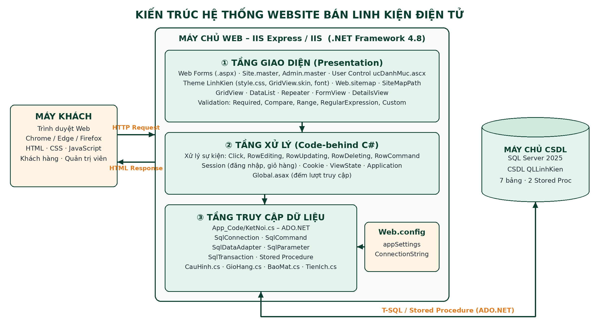

# Hướng dẫn cài đặt

## Các tập tin

| Tập tin | Dùng khi |
|---|---|
| `QLLinhKien.sql` | **Cài mới.** Tạo CSDL QLLinhKien gồm 7 bảng, 2 thủ tục lưu trữ và dữ liệu thử: 8 loại, 9 hãng, 28 sản phẩm, 3 tài khoản, 8 đơn hàng, cấu hình website. Đây là dữ liệu dùng cho các kết quả trong báo cáo |
| `CapNhat_DonHang.sql` | Chỉ dùng khi nâng cấp CSDL cũ: thêm cột HinhThucTT, EmailNhan |
| `CapNhat_CauHinh.sql` | Chỉ dùng khi nâng cấp CSDL cũ: thêm bảng tblCauHinh |
| `CapNhat_HinhAnh.sql` | Chỉ dùng khi nâng cấp CSDL cũ: đổi tên hình sản phẩm sang ảnh linh kiện thật (sp02.jpg … sp28.jpg) |
| `SoDoTrienKhai.png` | Sơ đồ triển khai và kiến trúc hệ thống |

## Sơ đồ triển khai

Toàn bộ hệ thống chạy trên **một máy Windows**:
- Trình duyệt → IIS Express (Visual Studio) → website ASP.NET.
- Website → SQL Server (CSDL QLLinhKien), kết nối bằng ADO.NET qua Windows Authentication.

## Các bước

**1. Cài phần mềm** theo danh sách trong [`../soft/README.md`](../soft/README.md).

**2. Tạo CSDL**
1. Mở SSMS và kết nối tới SQL Server của máy.
2. Mở `setup/QLLinhKien.sql`, nhấn **Execute (F5)**.
3. Kết quả hiện *"Tạo CSDL QLLinhKien thành công!"* là xong.

**3. Chuỗi kết nối:** mở `src/WebLinhKien/Web.config`, sửa `Data Source` cho đúng ô **Server name** khi kết nối trong SSMS.

| SQL Server trên máy | Data Source |
|---|---|
| Bản mặc định / Developer | `localhost` |
| Express | `.\SQLEXPRESS` |
| LocalDB | `(localdb)\MSSQLLocalDB` |

**4. Chạy website**
1. Nhấp đúp `src/WebLinhKien.sln`.
2. Trong Solution Explorer, chuột phải `Default.aspx` → **Set As Start Page**.
3. Nhấn **Ctrl + F5**.

**5. Tài khoản thử**

| Vai trò | Tên đăng nhập | Mật khẩu |
|---|---|---|
| Quản trị viên | admin | admin123 |
| Khách hàng | khachhang1 | 123456 |
| Khách hàng | khachhang2 | 123456 |

## Lỗi thường gặp

| Lỗi | Cách xử lý |
|---|---|
| *A network-related or instance-specific error…* | Sai `Data Source`, hoặc dịch vụ SQL Server chưa chạy |
| *Cannot open database "QLLinhKien"* | Chưa chạy `QLLinhKien.sql` |
| Không có mục *Set As Start Page* | Phải mở bằng `WebLinhKien.sln`, không dùng *Open Folder* |
| Thiếu .NET Framework 4.8 | Cài **.NET Framework 4.8 targeting pack** trong Visual Studio Installer |
